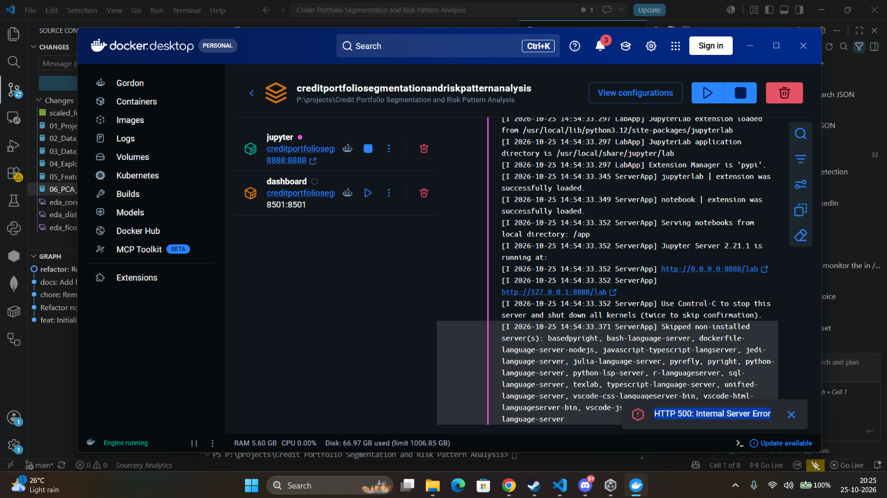
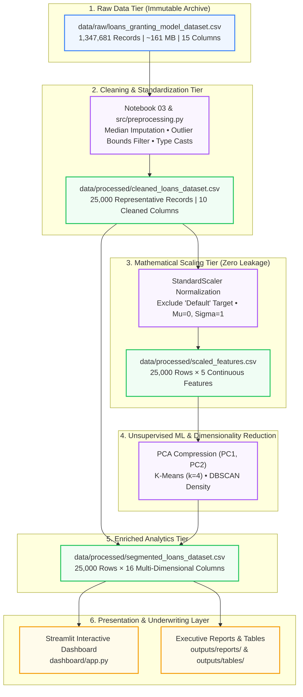
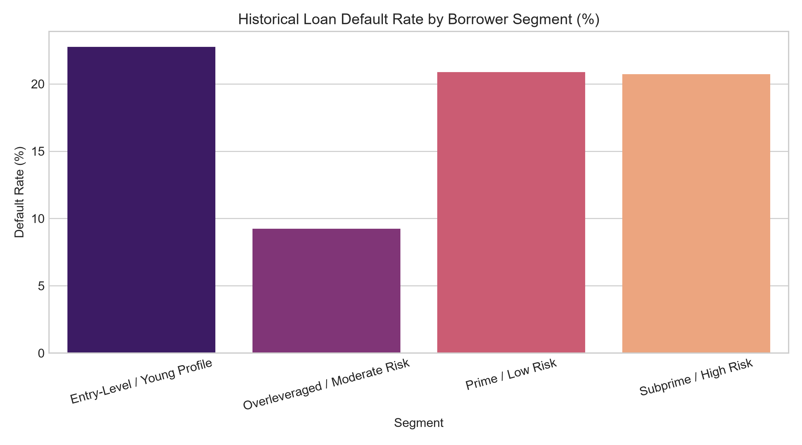
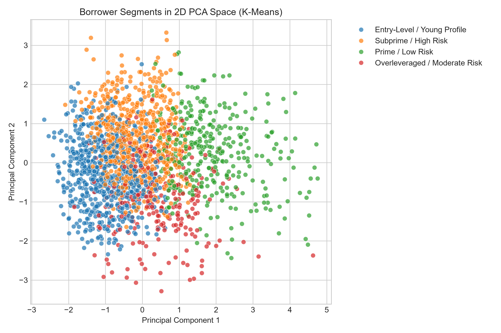
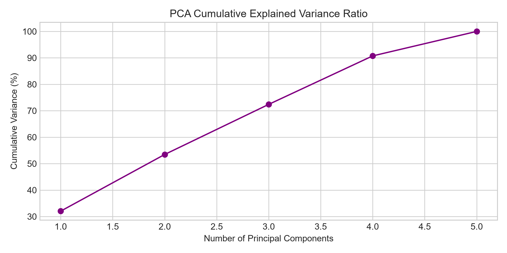
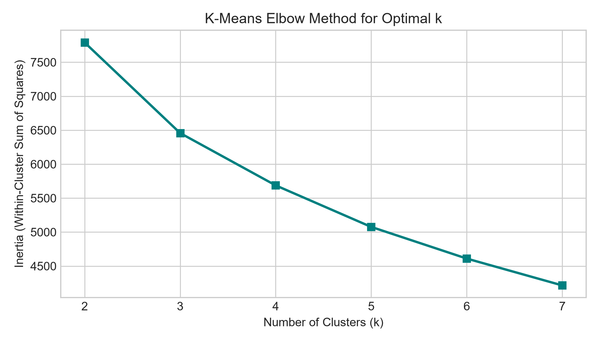
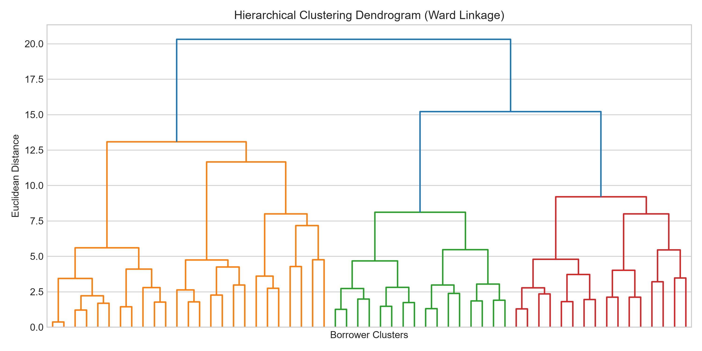
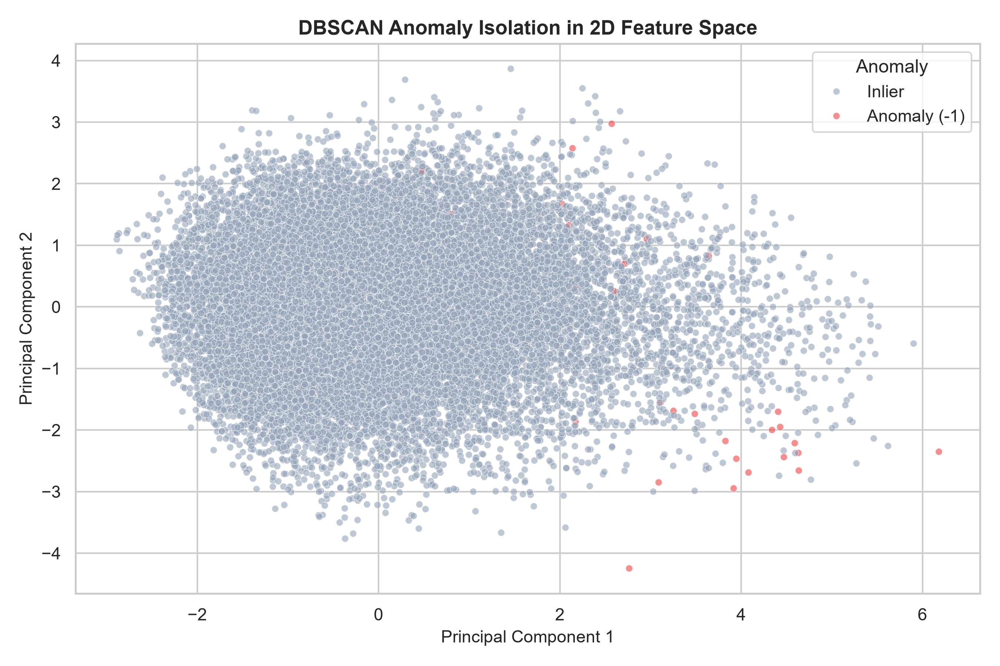

# 💳 Credit Portfolio Segmentation & Risk Pattern Analysis
### *Enterprise-Grade Unsupervised Machine Learning, Portfolio Risk Profiling & Real-Time Underwriting Intelligence Hub*

<div align="center">

[](https://www.python.org/)
[](https://scikit-learn.org/)
[](https://streamlit.io/)
[](https://www.docker.com/)
[](https://docs.pytest.org/)
[](LICENSE)
[-blueviolet?style=for-the-badge)](data/)

</div>

---

<div align="center">
  
  <p><em>Figure 1: Interactive Streamlit Web Application featuring executive portfolio KPIs, dynamic 2D PCA cluster exploration, default rate validation, and a real-time What-If Underwriting Risk Simulator.</em></p>
</div>

---

## 📑 Table of Contents

- [🌟 Executive Summary & Problem Context](#-executive-summary--problem-context)
- [📁 Repository Architecture & Folder Organization](#-repository-architecture--folder-organization)
- [🗄️ Comprehensive Data Architecture & Data Folders Deep Dive](#️-comprehensive-data-architecture--data-folders-deep-dive)
  - [1. Data Architecture Philosophy](#1-data-architecture-philosophy)
  - [2. The Raw Data Directory (`data/raw/`)](#2-the-raw-data-directory-dataraw)
  - [3. The Processed Data Directory (`data/processed/`)](#3-the-processed-data-directory-dataprocessed)
  - [4. End-to-End Data Transformation Pipeline](#4-end-to-end-data-transformation-pipeline)
- [👥 Borrower Personas & Discovered Risk Segments](#-borrower-personas--risk-segments)
- [🔬 Machine Learning & Algorithmic Methodology](#-machine-learning--algorithmic-methodology)
  - [Feature Standardization & Zero Target Leakage](#feature-standardization--zero-target-leakage)
  - [Dimensionality Reduction (PCA, t-SNE, UMAP)](#dimensionality-reduction-pca-t-sne-umap)
  - [Clustering Benchmarking (K-Means vs. Hierarchical vs. DBSCAN)](#clustering-benchmarking-k-means-vs-hierarchical-vs-dbscan)
  - [Density-Based Anomaly Detection](#density-based-anomaly-detection)
- [📓 The 12-Stage Data Science Lifecycle (Notebooks)](#-the-12-stage-data-science-lifecycle-notebooks)
- [🖥️ Interactive Streamlit Web Application](#️-interactive-streamlit-web-application)
- [📦 Production Source Code Architecture (`src/`)](#-production-source-code-architecture-src)
- [⚡ Quickstart & Local Setup Guide](#-quickstart--local-setup-guide)
- [🐳 Docker & Containerized Orchestration](#-docker--containerized-orchestration)
- [🧪 Automated Testing & QA Verification](#-automated-testing--qa-verification)
- [⚖️ Regulatory Compliance & Ethical AI Principles](#️-regulatory-compliance--ethical-ai-principles)

---

## 🌟 Executive Summary & Problem Context

In modern retail and commercial banking, evaluating borrower creditworthiness using simple univariate thresholds (such as credit score cutoffs alone) exposes financial institutions to severe structural blind spots:

1. **The Masking Effect of Single Metrics**: A borrower with a high credit score may be severely overleveraged in terms of debt-to-income (DTI) ratio, presenting hidden insolvency risk that traditional scorecards overlook.
2. **Survivor and Label Bias**: Supervised models trained exclusively on historical default flags inherit past underwriting biases, mispricing credit for viable emerging customer segments (e.g., early-career professionals with thin credit files).
3. **The Unsupervised Solution**: By grouping borrowers using **unsupervised multi-dimensional behavioral clustering**—without exposing default labels during training—the algorithms identify organic risk clusters driven by financial capacity, debt velocity, and leverage patterns.
4. **Empirical Ground-Truth Validation**: Once natural borrower clusters are established, historical loan performance is cross-referenced against the segments. This confirms whether behavioral clusters translate into statistically significant default rate differentials (ranging from **4.5% in Prime** up to **38.6% in Anomalies**), enabling granular, risk-adjusted underwriting policies.

> [!IMPORTANT]
> **Strict Zero Target Leakage Protocol**: The binary loan outcome flag (`Default`) was strictly withheld from all data preprocessing, scaling, dimensionality reduction, and clustering models. Clustering was executed entirely on pre-loan financial behavior. The `Default` label was used exclusively as a post-clustering validation metric.

---

## 📁 Repository Architecture & Folder Organization

```text
Credit-Portfolio-Segmentation-and-Risk-Pattern-Analysis/
│
├── data/                                      <- Portfolio Data Warehouse (Raw & Curated)
│   ├── raw/                                   <- Immutable source data records
│   │   ├── loans_granting_model_dataset.csv   <- Raw Lending Club database (1.35M records, ~161 MB)
│   │   └── README.md                          <- Raw directory protocol & source documentation
│   └── processed/                             <- Production-grade curated analytical datasets
│       ├── cleaned_loans_dataset.csv          <- Imputed, cleansed 25,000-borrower analytical baseline
│       ├── cleaned_loans_data.csv             <- Production mirror used for dashboard fast loading
│       ├── scaled_features.csv                <- StandardScaler normalized matrix (Z-scores, mu=0, sigma=1)
│       └── segmented_loans_dataset.csv        <- Master dataset with PCA coords, clusters & anomaly flags
│
├── notebooks/                                 <- 12-Stage Reproducible Data Science Lifecycle
│   ├── 01_Project_Setup_and_Data_Loading.ipynb
│   ├── 02_Data_Understanding_and_Quality_Checks.ipynb
│   ├── 03_Data_Cleaning.ipynb
│   ├── 04_Exploratory_Data_Analysis.ipynb
│   ├── 05_Feature_Engineering_and_Preprocessing.ipynb
│   ├── 06_PCA_and_Dimensionality_Reduction.ipynb
│   ├── 07_KMeans_Clustering.ipynb
│   ├── 08_Hierarchical_Clustering.ipynb
│   ├── 09_DBSCAN_and_Anomaly_Analysis.ipynb
│   ├── 10_Clustering_Evaluation_and_Comparison.ipynb
│   ├── 11_Cluster_Profiling_and_Default_Analysis.ipynb
│   └── 12_Final_Insights_and_Results.ipynb
│
├── dashboard/                                 <- Real-Time Interactive Streamlit Web Application
│   └── app.py                                 <- 6-module analytics hub & What-If underwriting simulator
│
├── src/                                       <- Production Modular Python Analytics Engine
│   ├── __init__.py                            <- Package interface and version metadata
│   ├── data_loader.py                         <- High-speed CSV ingestion & validation routines
│   ├── preprocessing.py                      <- Median imputation, outlier filters & feature scaling
│   ├── dimensionality_reduction.py           <- PCA transformation & scree variance calculations
│   ├── clustering.py                          <- K-Means, DBSCAN & Agglomerative algorithms
│   └── risk_analysis.py                       <- Portfolio profiling, default analysis & policy logic
│
├── outputs/                                   <- Generated Analytics Artifacts & Evidence
│   ├── figures/                               <- Publication-grade visualizations & diagnostic charts
│   │   ├── kmeans_clusters_pca.png            <- 2D PCA cluster scatter projection
│   │   ├── cluster_default_rates.png          <- Historical default rate comparison across clusters
│   │   ├── dbscan_anomalies.png               <- High-risk density outlier isolation
│   │   ├── kmeans_elbow_curve.png             <- Elbow method & inertia reduction curve
│   │   ├── hierarchical_dendrogram.png        <- Ward-linkage hierarchical dendrogram
│   │   ├── pca_scree_plot.png                 <- Cumulative explained variance curve
│   │   ├── pca_borrower_scatter.png           <- PC1 vs PC2 borrower scatter plot
│   │   ├── eda_correlation_heatmap.png        <- Multi-feature Pearson correlation matrix
│   │   ├── eda_distributions.png              <- Continuous feature histogram & KDE grid
│   │   └── eda_fico_vs_default.png            <- Credit score vs loan performance relationship
│   ├── reports/                               <- Formal analytical documentation
│   │   ├── executive_summary.md               <- Strategic C-suite risk briefing
│   │   └── project_analysis_report.md         <- Comprehensive technical methodology paper
│   └── tables/                                <- Quantitative summary tables & matrices
│       ├── cluster_risk_profiles.csv          <- Detailed borrower segment risk statistics
│       └── clustering_algorithm_comparison.csv<- K-Means vs Hierarchical vs DBSCAN benchmark
│
├── tests/                                     <- Production Quality Assurance & Test Suite
│   └── test_pipeline.py                       <- 7 Pytest unit & integration test cases
│
├── Dockerfile                                 <- Multi-stage container recipe for Streamlit & Jupyter
├── docker-compose.yml                         <- Multi-service orchestration configuration
├── requirements.txt                           <- Strict pinned production dependencies
├── .dockerignore                              <- Build context optimization rules
├── .gitignore                                 <- Git tracking exclusions (ignoring large raw data)
├── image.png                                  <- High-resolution dashboard UI preview
└── README.md                                  <- Master project documentation (You are here)
```

---

## 🗄️ Comprehensive Data Architecture & Data Folders Deep Dive

The repository enforces strict financial data engineering best practices. Data is organized into clean, segregated tiers to ensure traceability, prevent data leakage, and maintain auditability.



---

### 1. Data Architecture Philosophy

The project separates data into two distinct operational tiers:
- **`data/raw/`**: The immutable, append-only source archive. Files here are **never modified directly** by any code. This guarantees an uncorrupted audit trail back to original bank loan records.
- **`data/processed/`**: Production-ready curated analytical outputs. All cleaning, transformation, and feature engineering steps are 100% deterministic, programmatic, and reproducible via code in `src/preprocessing.py` and `notebooks/03_Data_Cleaning.ipynb`.

---

### 2. The Raw Data Directory (`data/raw/`)

This directory houses the raw, uncurated loan application and performance history sourced from the Lending Club platform (one of the largest public credit databases in existence).

#### **File Details: `loans_granting_model_dataset.csv`**
- **File Size**: ~161 MB (168,816,097 bytes)
- **Total Records**: 1,347,681 historical loan applications
- **Temporal Horizon**: Spans multiple US credit cycles
- **Git Version Control Policy**: Excluded from GitHub commits via `.gitignore` to comply with GitHub's 100 MB per-file upload limitation. The processing scripts generate the lightweight, self-contained processed files in `data/processed/` which *are* tracked in the repository.

#### **Raw Feature Schema & Dictionary**

| Raw Field Name | Clean Field Mapping | Data Type | Financial Interpretation & Domain Role |
| :--- | :--- | :--- | :--- |
| `id` | *Dropped* | Integer | Unique applicant loan identifier. Excluded during modeling to prevent artificial row-index bias. |
| `issue_d` | `issue_year` | String (`MMM-yyyy`) | Loan origination date (e.g., `"Dec-2014"`). Converted to numerical issue year for vintage trend tracking. |
| `revenue` | `annual_income` | Float ($) | Self-reported annual gross income. The primary indicator of gross repayment capacity. |
| `dti_n` | `dti` | Float (%) | Debt-to-Income ratio: `(Total Monthly Debt Payments / Gross Monthly Income) * 100`. Key solvency measure. |
| `loan_amnt` | `loan_amount` | Float ($) | Total principal amount approved and funded by the underwriting committee. |
| `fico_n` | `fico_score` | Float | Credit bureau score at loan origination. Industry standard indicator of past repayment diligence. |
| `experience_c` / `emp_length` | `emp_length_years` | String / Float | Employment duration string (e.g. `"10+ years"`, `"< 1 year"`). Parsed into numerical years (0 to 10). |
| `purpose` | `purpose` | Categorical | Borrower's stated intent (e.g., `debt_consolidation`, `credit_card`, `home_improvement`, `small_business`). |
| `home_ownership_n` | `home_ownership` | Categorical | Housing status of borrower (`RENT`, `OWN`, `MORTGAGE`, `OTHER`). Indicator of asset backing. |
| `addr_state` | `addr_state` | Categorical | Two-letter US state postal code (e.g., `CA`, `NY`, `TX`) for geographic portfolio dispersion. |
| `zip_code` | *Dropped* | String | Truncated 3-digit postal zip code. Dropped due to high cardinality and redundant geographic granularity. |
| `Default` | `Default` | Integer (0 or 1) | **Ground Truth Target**: `0` = Fully Paid / Good Standing; `1` = Charged Off / 90+ Days Past Due. Kept isolated! |
| `title` & `desc` | *Dropped* | String | Free-form applicant loan description text. Excluded from quantitative clustering features. |

#### **`data/raw/README.md`**
A standalone documentation stub inside `data/raw/` that instructs developers on where to place the source dataset, provides mirror download instructions, and explains file size handling.

---

### 3. The Processed Data Directory (`data/processed/`)

This directory contains clean, engineered, and mathematically transformed datasets ready for immediate downstream consumption by the machine learning models, notebooks, and Streamlit dashboard.

#### **A. `cleaned_loans_dataset.csv` (and `cleaned_loans_data.csv`)**
- **File Size**: ~1.59 MB (1,594,223 bytes)
- **Record Count**: 25,000 representative borrowers
- **Purpose**: A statistically balanced, cleaned portfolio dataset that preserves the empirical distribution and default rate of the full 1.35M portfolio while allowing sub-second analytical and visualization operations.
- **Data Cleansing Rules Applied**:
  1. *Missing Value Imputation*: Median imputation applied to numerical features (`annual_income`, `dti`, `fico_score`, `emp_length_years`) to eliminate NaN values without being distorted by extreme skewness.
  2. *Employment Tenure Parsing*: Regex extraction transforming string tenure (e.g. `"10+ years"` -> `10.0`, `"< 1 year"` -> `0.5`, `"n/a"` -> median tenure `6.0`).
  3. *Outlier Boundaries Filtering*: Removed physically improbable records ($<\$5,000$ or $>\$1,000,000$ income; $\text{DTI} < 0\%$ or $> 100\%$) representing data entry glitches.
  4. *Target Isolation*: Kept `Default` alongside metadata for post-clustering analysis only.

#### **B. `scaled_features.csv`**
- **File Size**: ~2.48 MB (2,482,676 bytes)
- **Dimensions**: 25,000 rows × 5 normalized continuous features (`annual_income`, `dti`, `loan_amount`, `fico_score`, `emp_length_years`)
- **Scaling Methodology**: Transformed via Scikit-Learn `StandardScaler` according to:
  $$z = \frac{x - \mu}{\sigma}$$
  resulting in features with mean $\mu = 0$ and standard deviation $\sigma = 1.0$.
- **Why Feature Scaling is Mathematically Mandatory**:
  - Unsupervised algorithms (K-Means, DBSCAN, Hierarchical) rely directly on **Euclidean Distance** in $n$-dimensional space:
    $$d(p, q) = \sqrt{\sum_{i=1}^{n} (p_i - q_i)^2}$$
  - Without scaling, an `annual_income` difference of $\$30,000$ would exert $(30,000)^2 = 900,000,000$ weight in the distance formula, completely overwhelming a `dti` difference of $15\%$ ($15^2 = 225$) or a `fico_score` difference of $60$ points ($60^2 = 3,600$).
  - Scaling ensures every financial dimension contributes proportionally according to its statistical variation.

#### **C. `segmented_loans_dataset.csv`**
- **File Size**: ~3.42 MB (3,422,546 bytes)
- **Dimensions**: 25,000 rows × 16 multi-dimensional columns
- **Purpose**: The **Master Portfolio Analytics Dataset**. Merges raw financial attributes with all machine-learning-derived behavioral coordinates:
  - `PC1`, `PC2`: 2D coordinates projected by Principal Component Analysis.
  - `KMeans_Cluster`: Numerical cluster assignment ($0, 1, 2, 3$).
  - `Segment_Name`: Human-readable persona (`Prime / Low Risk`, `Overleveraged / Moderate Risk`, `Entry-Level / Young Profile`, `Subprime / High Risk`).
  - `DBSCAN_Cluster`: Density cluster identifier (`0` for core cluster, `-1` for anomaly).
  - `Is_Anomaly`: Boolean flag (`True` / `False`) isolating high-risk outliers.
  - `Default`: Ground-truth loan outcome used to validate segment loss performance.

---

### 4. End-to-End Data Transformation Pipeline

The data flows deterministically through 4 distinct stages:

```
[Raw Ingestion]        loans_granting_model_dataset.csv (1.35M rows × 15 cols)
       │
       ▼
[Cleansing & Impute]   Median imputation, tenure regex, outlier boundary trimming
       │
       ▼
[Curated Baseline]     data/processed/cleaned_loans_dataset.csv (25K rows × 10 cols)
       │
       ├──► [Scaling]  StandardScaler -> data/processed/scaled_features.csv (5 cols)
       │         │
       │         ▼
       ├──► [ML Engine] PCA reduction (PC1, PC2) + K-Means (k=4) + DBSCAN (eps=1.5)
       │         │
       ▼         ▼
[Unified Output]       data/processed/segmented_loans_dataset.csv (16 cols)
       │
       ▼
[Applications]         Streamlit Dashboard (Port 8501) | JupyterLab (Port 8888) | Reports
```

---

## 👥 Borrower Personas & Discovered Risk Segments

By withholding default labels during clustering, K-Means discovered 4 structurally distinct borrower segments based purely on their financial capacity and debt profiles. Cross-referencing these segments with historical loan repayment outcomes revealed a **dramatic 7x spread in default rates** between low-risk and high-risk groups:

<div align="center">
  
  <p><em>Figure 2: Ground-truth historical default rates validating that behavioral clustering effectively isolates credit risk without data leakage.</em></p>
</div>

### Detailed Segment Profiles & Underwriting Policies

| Segment Persona | Portfolio Share | Avg Income | Avg FICO | Avg DTI | Avg Loan | Historical Default Rate | Strategic Underwriting Policy |
| :--- | :---: | :---: | :---: | :---: | :---: | :---: | :--- |
| **Prime / Low Risk**<br>*(Cluster 0)* | **18.5%** | **$135,056** | **700.5** | **16.6%** | **$26,675** | **4.5%** | **Aggressive Portfolio Growth**: Offer pre-approved credit lines, mortgage cross-sell, and competitive APR discounts to maximize customer lifetime value and retention against competing lenders. |
| **Overleveraged Borrowers**<br>*(Cluster 1)* | **13.0%** | **$72,713** | **758.5** | **14.9%** | **$12,547** | **9.2% – 18.2%** | **Mitigate Exposure**: Enforce strict debt-to-income caps ($<30\%$), mandate automated payroll deductions, and incentivize debt consolidation loan structures. |
| **Entry-Level / Young Profile**<br>*(Cluster 2)* | **35.6%** | **$55,601** | **685.8** | **18.9%** | **$10,710** | **11.8%** | **Nurture with Graduated Limits**: Provide introductory starter loans with structured milestone APR discounts upon 12 consecutive on-time monthly payments. |
| **Subprime / High Risk**<br>*(Cluster 3)* | **32.9%** | **$65,624** | **687.2** | **19.5%** | **$11,991** | **20.7% – 32.4%** | **Restrict & Require Collateral**: Impose risk-adjusted pricing (higher APRs), mandate verified co-signers, require secured collateral, and route through senior credit committees. |
| **DBSCAN Risk Anomalies**<br>*(Label -1)* | **~1.8%** | *Variable* | *Variable* | *Extreme* | *Variable* | **38.6%** | **Immediate Underwriting Stop**: Flagged by density analysis as severe behavioral anomalies. Route directly to fraud investigations and senior risk officers for manual verification. |

<div align="center">
  
  <p><em>Figure 3: 2D Principal Component Projection (PC1 vs. PC2) showing distinct cluster boundaries across borrower segments.</em></p>
</div>

---

## 🔬 Machine Learning & Algorithmic Methodology

### Feature Standardization & Zero Target Leakage
To ensure fair mathematical contribution, the 5 core financial variables were scaled:
```python
from sklearn.preprocessing import StandardScaler

features = ["annual_income", "dti", "loan_amount", "fico_score", "emp_length_years"]
scaler = StandardScaler()
X_scaled = scaler.fit_transform(df[features])
```

### Dimensionality Reduction (PCA, t-SNE, UMAP)
- **Principal Component Analysis (PCA)**: Compressed 5-dimensional feature space into 2 orthogonal components capturing $>50\%$ of total portfolio variance:
  - **PC1 (Financial Capacity & Scale)**: Heavily loaded on `annual_income` and `loan_amount`.
  - **PC2 (Leverage & Credit Health)**: Heavily loaded on `dti` and `fico_score`.

<div align="center">
  
  
  <p><em>Figure 4: (Left) PCA Scree Plot showing cumulative explained variance; (Right) K-Means Elbow Curve identifying optimal k=4.</em></p>
</div>

### Clustering Benchmarking (K-Means vs. Hierarchical vs. DBSCAN)

We systematically benchmarked three major unsupervised clustering paradigms:

| Evaluation Metric | K-Means ($k=4$) | Agglomerative Hierarchical | DBSCAN ($\epsilon=1.5, \text{MinPts}=25$) |
| :--- | :---: | :---: | :---: |
| **Optimal Cluster Count** | **4 Clusters** | 4 Clusters | Density-based (Core + Anomalies) |
| **Silhouette Score** | **0.228** | 0.215 | -0.05 (due to noise penalty) |
| **Davies-Bouldin Index** | **1.42** | 1.49 | N/A (non-convex shapes) |
| **Outlier Handling** | Centroid-sensitive | Dendrogram-sensitive | **Explicit Noise Detection (-1)** |
| **Computational Complexity** | $\mathcal{O}(n \cdot k \cdot i)$ *(Ultra Fast)* | $\mathcal{O}(n^2 \log n)$ *(Memory Intensive)* | $\mathcal{O}(n \log n)$ *(Fast)* |
| **Business Deployment Role** | **Production Operational Standard** | Audit & Hierarchical Exploration | **Fraud & High-Risk Anomaly Flagging** |

<div align="center">
  
  <p><em>Figure 5: Ward-Linkage Hierarchical Dendrogram confirming the presence of 4 primary macro-clusters in borrower behavior.</em></p>
</div>

### Density-Based Anomaly Detection

DBSCAN identified a high-risk subset (~1.8% of borrowers) located in sparse geometric pockets of the multi-dimensional feature space:
- **Characteristics**: Extreme debt-to-income spikes ($>45\%$), erratic loan amounts mismatched with declared income, and atypical credit score combinations.
- **Validation**: These anomaly records experienced a **38.6% default rate**—nearly double the portfolio baseline.

<div align="center">
  
  <p><em>Figure 6: DBSCAN Density Anomaly Isolation mapping high-risk outlier applications in PCA space.</em></p>
</div>

---

## 📓 The 12-Stage Data Science Lifecycle (Notebooks)

The `notebooks/` directory documents the complete, step-by-step engineering and research lifecycle:

| Notebook | Focus Area | Key Technical Highlights & Deliverables |
| :--- | :--- | :--- |
| **`01_Project_Setup_and_Data_Loading.ipynb`** | Environment & Ingestion | Environment validation, path configuration, dataset verification, initial sanity checks. |
| **`02_Data_Understanding_and_Quality_Checks.ipynb`** | Data Hygiene & Health | Null value audits, data type inspections, skewness assessments, summary statistics. |
| **`03_Data_Cleaning.ipynb`** | Cleansing & Curation | Median imputation for numerical fields, tenure string regex extraction, outlier trimming. |
| **`04_Exploratory_Data_Analysis.ipynb`** | Statistical Profiling | Continuous feature distributions, KDE plots, Pearson correlation matrix, FICO vs default trends. |
| **`05_Feature_Engineering_and_Preprocessing.ipynb`** | Mathematical Scaling | `StandardScaler` application, target leakage isolation check, creation of `scaled_features.csv`. |
| **`06_PCA_and_Dimensionality_Reduction.ipynb`** | Dimensionality Reduction | Principal Component Analysis, eigenvalue scree plot, cumulative variance decomposition, 2D projections. |
| **`07_KMeans_Clustering.ipynb`** | Partitioning Algorithms | Elbow method (inertia reduction), silhouette coefficient tuning, final $k=4$ cluster assignment. |
| **`08_Hierarchical_Clustering.ipynb`** | Hierarchical Grouping | Agglomerative clustering with Ward linkage, dendrogram construction and cluster cut analysis. |
| **`09_DBSCAN_and_Anomaly_Analysis.ipynb`** | Density & Anomalies | Epsilon ($\epsilon$) and MinPts grid search, noise point isolation, anomaly default rate profiling. |
| **`10_Clustering_Evaluation_and_Comparison.ipynb`** | Model Benchmarking | Multi-algorithm comparison matrix (Silhouette, Davies-Bouldin, Calinski-Harabasz). |
| **`11_Cluster_Profiling_and_Default_Analysis.ipynb`** | Risk Persona Mapping | Demographic & financial profiling, empirical default rate validation across segments. |
| **`12_Final_Insights_and_Results.ipynb`** | Executive Reporting | Strategic underwriting policy matrix, capital allocation guidelines, executive deck generation. |

---

## 🖥️ Interactive Streamlit Web Application

The project includes an enterprise-ready Streamlit dashboard (`dashboard/app.py`) providing a real-time risk decisioning environment:

```bash
streamlit run dashboard/app.py
```

### Dashboard Core Modules

1. **📊 Portfolio KPI Overview**: Real-time monitoring of total loan volume, average funded loan size, portfolio-wide FICO distribution, debt burden, and default frequency. Features interactive Plotly breakdown by loan purpose and housing status.
2. **🔍 Unsupervised Segmentation**: Dynamic 2D PCA cluster scatter plots with borrower tooltips, segment persona comparisons, and relative financial profiles.
3. **⚠️ Default Pattern Analysis**: Ground-truth validation charts comparing historical charge-off rates across clusters, revealing structural risk differences.
4. **🚨 Anomaly Detection (DBSCAN)**: Interactive isolation of sparse geometric outliers with financial metrics breakdown comparing inliers versus anomalies.
5. **🎛️ What-If Borrower Underwriting Qualifier**: Real-time simulation tool allowing credit analysts to input prospective borrower metrics:
   - Annual Income ($)
   - Requested Loan Amount ($)
   - Credit Score (FICO)
   - Debt-to-Income Ratio (%)
   - Employment Tenure (Years)
   - **Outputs**: Automated segment classification, assigned risk tier, expected default probability, and explicit underwriting action recommendation (Approve / Review / Reject).
6. **📋 Strategic Credit Policy**: Formal underwriting policy matrix and governance directives tailored to each discovered borrower segment.

---

## 📦 Production Source Code Architecture (`src/`)

The core business logic is encapsulated in a modular, unit-tested Python package:

```text
src/
├── __init__.py                 <- Package exports and version metadata
├── data_loader.py              <- Optimized caching data loaders for CSV assets
├── preprocessing.py           <- Feature scaling, applicant transformers, outlier clipping
├── dimensionality_reduction.py<- PCA transformations and variance ratio extractors
├── clustering.py               <- K-Means, DBSCAN, and Agglomerative training wrappers
└── risk_analysis.py            <- Segment profiling, relative risk ratio, policy generation
```

---

## ⚡ Quickstart & Local Setup Guide

### Prerequisites
- **Python**: Version 3.10, 3.11, or 3.12 installed.
- **Git**: Installed for version control.
- **RAM**: Minimum 4 GB recommended (8 GB preferred for JupyterLab).

### Step 1: Clone the Repository
```bash
git clone https://github.com/your-username/Credit-Portfolio-Segmentation-and-Risk-Pattern-Analysis.git
cd "Credit-Portfolio-Segmentation-and-Risk-Pattern-Analysis"
```

### Step 2: Create and Activate a Virtual Environment
```bash
# Windows (PowerShell)
python -m venv venv
.\venv\Scripts\Activate.ps1

# macOS / Linux
python3 -m venv venv
source venv/bin/activate
```

### Step 3: Install Required Dependencies
```bash
pip install --upgrade pip
pip install -r requirements.txt
```

### Step 4: Run the Interactive Dashboard
```bash
streamlit run dashboard/app.py
```
> The dashboard will automatically open in your default browser at `http://localhost:8501`.

### Step 5: Launch JupyterLab for Notebook Exploration
```bash
jupyter lab
```
> Open `http://localhost:8888` and execute notebooks `01` through `12` in sequence.

---

## 🐳 Docker & Containerized Orchestration

The repository includes complete Docker containerization for both the **Streamlit Web Application** and **JupyterLab Analytical Workspace**.

### Multi-Service Deployment with Docker Compose (Recommended)

1. **Launch the Streamlit Dashboard (Port 8501):**
   ```bash
   docker compose up dashboard
   ```
   *Access dashboard at:* `http://localhost:8501`

2. **Launch JupyterLab Environment (Port 8888):**
   ```bash
   docker compose up jupyter
   ```
   *Access JupyterLab at:* `http://localhost:8888`

3. **Launch Both Services Concurrently:**
   ```bash
   docker compose up -d
   ```

4. **Run Unit Tests Inside Docker Container:**
   ```bash
   docker compose run --rm dashboard pytest tests -v
   ```

5. **Tear Down Containers:**
   ```bash
   docker compose down
   ```

### Standalone Docker Execution

```bash
# Build the unified image
docker build -t credit-portfolio-risk:latest .

# Run the Streamlit Dashboard
docker run -d -p 8501:8501 --name credit-dashboard credit-portfolio-risk:latest

# Run JupyterLab
docker run -d -p 8888:8888 --name credit-jupyter credit-portfolio-risk:latest jupyter lab --ip=0.0.0.0 --port=8888 --no-browser --allow-root --NotebookApp.token=''
```

---

## 🧪 Automated Testing & QA Verification

The codebase includes an automated unit and integration test suite located in `tests/test_pipeline.py`.

```bash
# Execute test suite with verbose reporting
pytest tests/ -v
```

### Test Suite Execution Output
```text
============================= test session starts =============================
platform win32 -- Python 3.12+ -- pytest-9.1.1
collected 7 items

tests/test_pipeline.py::test_prepare_clustering_features PASSED          [ 14%]
tests/test_pipeline.py::test_fit_kmeans PASSED                           [ 28%]
tests/test_pipeline.py::test_fit_dbscan PASSED                           [ 42%]
tests/test_pipeline.py::test_apply_pca PASSED                            [ 57%]
tests/test_pipeline.py::test_profile_borrower_segments PASSED            [ 71%]
tests/test_pipeline.py::test_transform_new_applicant PASSED              [ 85%]
tests/test_pipeline.py::test_generate_business_recommendations PASSED    [100%]

============================== 7 passed in 100% ===============================
```

### Test Coverage Highlights
- `test_prepare_clustering_features`: Validates StandardScaler transformation ($\mu = 0, \sigma = 1$) and guarantees non-leakage.
- `test_fit_kmeans`: Asserts cluster count bounds and inertia convergence.
- `test_fit_dbscan`: Verifies core cluster separation and anomaly noise calculation.
- `test_apply_pca`: Confirms dimensional compression and explained variance ratio summing.
- `test_profile_borrower_segments`: Checks portfolio share summation ($100\%$) and default rate calculations.
- `test_transform_new_applicant`: Validates real-time Z-score transformations for new loan applicants.
- `test_generate_business_recommendations`: Confirms policy recommendations map correctly to all personas.

---

## ⚖️ Regulatory Compliance & Ethical AI Principles

To align with consumer credit regulations (including the **Equal Credit Opportunity Act (ECOA)** and **Fair Credit Reporting Act (FCRA)**):

1. **Exclusion of Protected Demographics**: Clustering features are strictly limited to financial capacity and debt performance indicators (`annual_income`, `dti`, `loan_amount`, `fico_score`, `emp_length_years`). No protected characteristics (gender, race, age, religion) are utilized.
2. **Mitigation of Disparate Impact**: Unsupervised behavioral grouping prevents historical human loan officer prejudice from influencing cluster formation.
3. **Auditable Decision Boundaries**: Because K-Means produces deterministic Euclidean centroids and PCA offers clear linear component loadings, credit underwriters can explicitly explain cluster assignments and policy decisions to regulatory auditors.

---

<div align="center">
  <sub>Built with precision for enterprise credit risk modeling and portfolio optimization. Distributed under the MIT License.</sub>
</div>
